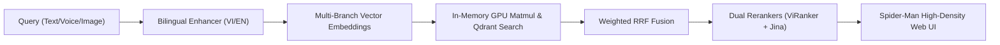

# 🕷️ Super Image Retrieval System for AIC2026

<div align="center">

[](https://python.org)
[](https://fastapi.tiangolo.com)
[](https://qdrant.tech)
[](https://pytorch.org)
[](https://docker.com)
[](LICENSE)

**Hệ thống tìm kiếm và truy xuất video keyframe thời gian thực siêu tốc phục vụ cuộc thi AI Challenge HCMC 2026.**

[🎯 Tổng Quan](#-tổng-quan-dự-án) •
[🚀 Cài Đặt Nhanh](#-hướng-dẫn-cài-đặt-nhanh-quick-start) •
[🏗️ Kiến Trúc](#️-kiến-trúc-hệ-thống) •
[🕸️ Web UI](#️-spider-man-web-ui) •
[🧪 Kiểm Thử](#-kiểm-thử-test--quality) •
[📚 Tài Liệu Chi Tiết](docs/README.md)

</div>

---

## 🎯 Tổng Quan Dự Án

* **Mục tiêu:** Truy xuất keyframe video chính xác cao trong thời gian thực ($< 1.5\text{s}$) từ kho dữ liệu video khổng lồ với giao diện mật độ cao.
* **4 Tác vụ chính:**
  1. **KIS (Known-Item Search):** Tìm kiếm phân đoạn video theo mô tả văn bản tiếng Việt/Anh hoặc giọng nói.
  2. **VQA (Visual Question Answering):** Trả lời câu hỏi thị giác và truy xuất keyframe chứa bằng chứng.
  3. **TRAKE (Temporal Retrieval):** Tìm kiếm chuỗi sự kiện đa bước diễn ra theo trình tự thời gian (DANTE DP).
  4. **Image-to-Image Search:** Tìm kiếm keyframe tương đồng trực tiếp từ ảnh mẫu.
* **Quy mô dữ liệu thực tế:** **872 video gốc** (130.13 giờ), **90,551 keyframe sạch** đã lập chỉ mục.
* **Vector Database:** [Qdrant](https://qdrant.tech) collection `aic2026_clean_v3` (alias: `production`).

---

## 🚀 Hướng Dẫn Cài Đặt Nhanh (Quick Start)

Hệ thống hỗ trợ 2 hình thức triển khai: **Cài đặt Native trên máy (Khuyên dùng để tối ưu GPU)** hoặc **Chạy bằng Docker**.

### 💻 LỰA CHỌN 1: Cài Đặt Native (Khuyên dùng cho Máy thi & Teammate)

#### Bước 1: Clone Repository & Cài Đặt Môi Trường với `uv`

##### 🪟 Dành cho Windows (NVIDIA GPU CUDA):
```powershell
git clone https://github.com/ThanhDanh1510/Super-Image-Retrieval-System-for-AIC2026.git
cd Super-Image-Retrieval-System-for-AIC2026

pip install uv
uv venv .venv
.venv\Scripts\Activate.ps1

# Cài đặt PyTorch CUDA 12.4 và toàn bộ dependencies
uv pip install torch torchvision torchaudio --index-url https://download.pytorch.org/whl/cu124
uv pip install -e ".[all]"
```

##### 🍏 Dành cho macOS (Apple Silicon MPS):
```bash
git clone https://github.com/ThanhDanh1510/Super-Image-Retrieval-System-for-AIC2026.git
cd Super-Image-Retrieval-System-for-AIC2026

pip3 install uv
uv venv .venv
source .venv/bin/activate
uv pip install torch torchvision torchaudio
uv pip install -e ".[macos-server,test]"
```

---

#### Bước 2: Chuẩn Bị & Giải Nén Thư Mục Dữ Liệu (`data/`)

* 📥 **Tải gói dữ liệu**:
  * **Dành cho Teammate (Đã có sẵn folder ảnh):** Tải gói `aic2026_data_bundle_for_team.zip` (~757 MB) và giải nén đè vào thư mục `data/` (giữ nguyên thư mục ảnh `data/image/` sẵn có trên máy).
  * **Dành cho Máy mới hoàn toàn:** Tải toàn bộ thư mục dữ liệu tại [Google Drive Data Folder (AIC2026)](https://drive.google.com/drive/folders/174LtGV8Zex9TSD0eTajtVaY59DSi23kF).

* 📂 **Cấu trúc thư mục `data/` chuẩn sau khi giải nén:**
  ```text
  data/
  ├── image/                     # Thư mục ảnh keyframe (.webp)
  ├── unified/                   # 11 file vector & parquet sạch (đã cập nhật L25 Gemini)
  │   ├── scene_descriptions.parquet
  │   ├── description_embeddings.npy
  │   ├── image_vectors.npy
  │   └── ...
  ├── gemini_output/             # JSON mô tả chi tiết VLM
  └── translation_cache.json     # Cache dịch song ngữ tức thì (<1ms)
  ```

---

#### Bước 3: Khởi Động Qdrant & Nạp Dữ Liệu (Indexing)

```bash
# 3.1 Khởi động Qdrant Vector DB
docker compose up -d qdrant

# 3.2 Nạp dữ liệu từ data/unified vào Qdrant (mất ~1 phút cho 88,899 points)
python -m indexing.run_index --dataset-dir ./data/unified --collection aic2026_clean_v3 --create-collection
```

---

#### Bước 4: Khởi Động Server & Trải Nghiệm Web UI

```bash
python start_api.py
```
* 🌐 **Spider-Man Web UI:** [http://localhost:8000/ui/index.html](http://localhost:8000/ui/index.html)
* 📚 **API Swagger Docs:** [http://localhost:8000/docs](http://localhost:8000/docs)
* 🗄️ **Qdrant Dashboard:** [http://localhost:6333/dashboard](http://localhost:6333/dashboard)

---

### 🐳 LỰA CHỌN 2: Chạy Full-Stack Bằng Docker

```bash
# Sau khi chuẩn bị thư mục data/, chỉ cần 1 lệnh:
docker compose up -d
```

---

## 🏗️ Kiến Trúc Hệ Thống



> 📖 **Xem chi tiết tại:** [docs/architecture/system_architecture.md](docs/architecture/system_architecture.md)

---

## 🕸️ Spider-Man Web UI

* 🎨 **Mật độ cao (High-Density)**: Theme Neon Đỏ/Xanh, hỗ trợ lưới chuyển đổi nhanh **4x / 6x / 8x**.
* 🎬 **Trình xem Video HTTP Range 206**: Tự động tua chính xác tới timestamp của keyframe.
* 🧺 **Giỏ bài nộp thông minh**: Phím tắt **`C`** thêm/xóa nhanh vào giỏ, 1-Click xuất file CSV chuẩn AIC.
* 🎛️ **Dual Reranker Switches**: Bật/tắt linh hoạt ViRanker và Jina Cross-modal.

---

## 📚 Trung Tâm Tài Liệu (Documentation Hub)

Toàn bộ tài liệu chi tiết được tổ chức trong thư mục [`docs/`](docs/README.md):

* 🏗️ [**Kiến Trúc & Model Specs**](docs/architecture/system_architecture.md)
* 🔌 [**Tài Liệu API Endpoints & Schemas**](docs/architecture/api_reference.md)
* 🔍 [**Thuật Toán KIS & Exact-Match Tiered Scoring**](docs/algorithms/kis_retrieval.md)
* ⏱️ [**Thuật Toán Dòng Thời Gian TRAKE (DANTE Engine)**](docs/algorithms/trake_temporal.md)
* 🛠️ [**Bộ Công Cụ Tiện Ích & Web UI Lọc Ảnh**](docs/guides/tools_and_pipelines.md)
* 🏆 [**Thể Lệ & Định Dạng Nộp Bài AIC2026**](docs/guides/contest_rules.md)

---

## 🧪 Kiểm Thử (Test & Quality)

```bash
# Chạy bộ test suite (tương thích cả Windows, macOS MPS và Linux):
pytest tests/ -v
```

---

<div align="center">

**Built with ❤️ for AI Challenge Ho Chi Minh City 2026 (AIC2026).**

</div>
