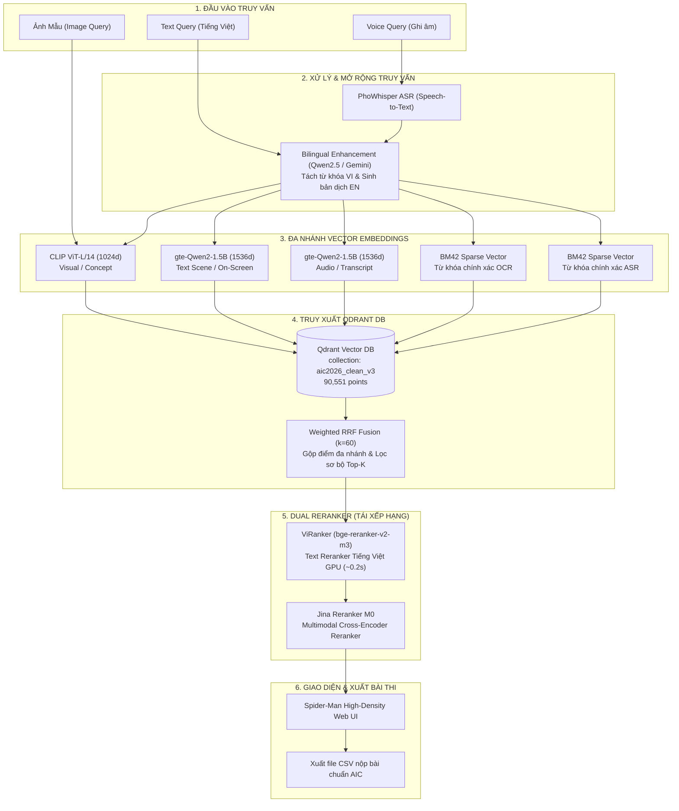

# 🕷️ Super Image Retrieval System for AIC2026

<div align="center">

[](https://python.org)
[](https://fastapi.tiangolo.com)
[](https://qdrant.tech)
[](https://pytorch.org)
[](https://docker.com)
[](LICENSE)

**Hệ thống tìm kiếm và truy xuất video keyframe thời gian thực siêu tốc phục vụ cuộc thi AI Challenge HCMC 2026.**

[🎯 Tổng Quan](#-tổng-quan-dự-án) •
[🚀 Cài Đặt Nhanh](#-hướng-dẫn-cài-đặt-nhanh-quick-start) •
[🏗️ Kiến Trúc](#️-kiến-trúc-hệ-thống-architecture) •
[🔌 API Endpoints](#-api-endpoints) •
[🧠 AI Models](#-ai-models) •
[🕸️ Web UI](#️-spider-man-web-ui) •
[🛠️ Bộ Công Cụ](#️-bộ-công-cụ-tiện-ích-tools--pipelines) •
[🧪 Kiểm Thử](#-test--code-quality)

</div>

---

## 🎯 Tổng Quan Dự Án

* **Tên dự án:** Super Image Retrieval System for AIC2026
* **Mục tiêu:** Truy xuất keyframe video chính xác cao trong thời gian thực ($< 1.5\text{s}$) từ kho dữ liệu video khổng lồ với giao diện mật độ cao.
* **4 Nhiệm vụ chính (Tasks):**
  1. **KIS (Known-Item Search):** Tìm kiếm phân đoạn video theo mô tả văn bản tiếng Việt/Anh hoặc giọng nói.
  2. **VQA (Visual Question Answering):** Trả lời câu hỏi thị giác và truy xuất keyframe chứa bằng chứng.
  3. **TRAKE (Temporal Retrieval):** Tìm kiếm chuỗi sự kiện đa bước diễn ra theo trình tự thời gian.
  4. **Image-to-Image Search:** Tìm kiếm keyframe tương đồng trực tiếp từ ảnh mẫu.
* **Quy mô dữ liệu thực tế:** **872 video gốc** (130.13 giờ), **90,551 keyframe sạch** đã được trích xuất vector và lập chỉ mục hoàn chỉnh.
* **Vector Database:** [Qdrant](https://qdrant.tech) collection `aic2026_clean_v3` (alias: `production`).

---

## 🚀 Hướng Dẫn Cài Đặt & Chạy Hệ Thống (Quick Start)

Hệ thống hỗ trợ 2 hình thức triển khai: **Cài đặt Native trên máy (Khuyên dùng để tối ưu tối đa GPU CUDA / Apple Silicon MPS)** hoặc **Chạy toàn bộ bằng Docker**.

---

### 💻 LỰA CHỌN 1: Cài Đặt Native (Khuyên dùng cho Máy thi & Teammate)

#### Bước 1: Clone Repository & Cài Đặt Môi Trường với `uv`

##### 🪟 Dành cho Windows (NVIDIA GPU CUDA):
```powershell
git clone https://github.com/ThanhDanh1510/Super-Image-Retrieval-System-for-AIC2026.git
cd Super-Image-Retrieval-System-for-AIC2026

pip install uv
uv venv .venv
.venv\Scripts\Activate.ps1

# Cài đặt PyTorch hỗ trợ CUDA 12.4 và toàn bộ dependencies
uv pip install torch torchvision torchaudio --index-url https://download.pytorch.org/whl/cu124
uv pip install -e ".[all]"
```

##### 🍏 Dành cho macOS (Apple Silicon M1/M2/M3/M4 & Intel):
```bash
git clone https://github.com/ThanhDanh1510/Super-Image-Retrieval-System-for-AIC2026.git
cd Super-Image-Retrieval-System-for-AIC2026

pip3 install uv
uv venv .venv
source .venv/bin/activate

# Cài đặt PyTorch & Dependencies (Tự động nhận diện Apple Metal MPS)
uv pip install torch torchvision torchaudio
uv pip install -e ".[macos-server,test]"
```

##### 🐧 Dành cho Ubuntu / Linux:
```bash
git clone https://github.com/ThanhDanh1510/Super-Image-Retrieval-System-for-AIC2026.git
cd Super-Image-Retrieval-System-for-AIC2026

pip3 install uv
uv venv .venv
source .venv/bin/activate
uv pip install -e ".[all]"
```

---

#### Bước 2: Chuẩn Bị & Giải Nén Thư Mục Dữ Liệu (`data/`)

* 📥 **Tải gói dữ liệu**:
  * **Dành cho Teammate (Đã có sẵn folder ảnh):** Tải gói dữ liệu tổng hợp `aic2026_data_bundle_for_team.zip` (~757 MB) và giải nén đè vào thư mục `data/` (giữ nguyên thư mục ảnh `data/image/` sẵn có trên máy).
  * **Dành cho Máy mới hoàn toàn:** Tải toàn bộ thư mục dữ liệu tại [Google Drive Data Folder (AIC2026)](https://drive.google.com/drive/folders/174LtGV8Zex9TSD0eTajtVaY59DSi23kF).

* 📂 **Cấu trúc thư mục `data/` chuẩn sau khi giải nén:**
  ```text
  data/
  ├── image/                     # Thư mục ảnh keyframe (.webp)
  ├── unified/                   # 11 file vector & parquet sạch (đã cập nhật L25 Gemini)
  │   ├── scene_descriptions.parquet
  │   ├── description_embeddings.npy
  │   ├── image_vectors.npy
  │   ├── ocr_text.parquet
  │   ├── asr_text.parquet
  │   └── ...
  ├── gemini_output/             # JSON mô tả chi tiết VLM
  └── translation_cache.json     # Cache dịch song ngữ tức thì (<1ms)
  ```

---

#### Bước 3: Khởi Động Qdrant & Nạp Dữ Liệu (Indexing)

```bash
# 3.1 Khởi động Qdrant Vector DB
docker compose up -d qdrant

# 3.2 Nạp dữ liệu từ data/unified vào Qdrant (mất ~1 phút cho 88,899 points)
python -m indexing.run_index --dataset-dir ./data/unified --collection aic2026_clean_v3 --create-collection
```

---

#### Bước 4: Khởi Động Server & Trải Nghiệm Web UI

```bash
python start_api.py
```
* 🌐 **Spider-Man Web UI:** [http://localhost:8000/ui/index.html](http://localhost:8000/ui/index.html)
* 📚 **API Swagger Docs:** [http://localhost:8000/docs](http://localhost:8000/docs)
* 🗄️ **Qdrant Dashboard:** [http://localhost:6333/dashboard](http://localhost:6333/dashboard)

---

### 🐳 LỰA CHỌN 2: Chạy Full-Stack Bằng Docker

Nếu bạn muốn chạy toàn bộ hệ thống (API + Qdrant) tự động qua container mà không cần cấu hình thủ công:
```bash
# Sau khi chuẩn bị thư mục data/, khởi chạy:
docker compose up -d
```

---

## 🏗️ Kiến Trúc Hệ Thống (Architecture)



---

## 📂 Cấu Trúc Dự Án (Project Structure)

```text
Super-Image-Retrieval-System-for-AIC2026/
├── configs/              # Cấu hình tập trung YAML (model_versions, fusion_config)
├── ingestion/            # Pipeline xử lý Kaggle GPU (trích xuất keyframe, OCR, ASR, embeddings)
│   └── skeletons/        # Scripts chuẩn hóa: 01a keyframe, 01b text, 01c embeddings, 02 export
├── aggregation/          # Hợp nhất shards dữ liệu phân tán thành unified dataset
├── indexing/             # Quản lý schema Qdrant, bulk index, và quản trị Zero-Downtime Alias
├── serving/              # Backend FastAPI (Kiến trúc phân lớp chuẩn: controller → service → repo)
│   └── api/
│       ├── controller/   # Route handlers (KIS, VQA, TRAKE, Similar Image, Media streaming)
│       ├── service/      # Nghiệp vụ tìm kiếm, RRF fusion, Dual Rerankers
│       ├── repo/         # Qdrant client abstraction và truy vấn vector
│       ├── core/         # Settings, ModelRegistry lazy-loading, Latency middleware
│       └── schema/       # Pydantic schemas request/response
├── shared/               # Code dùng chung: schemas, text normalizer, model wrappers, path resolver
├── eval/                 # Offline benchmark & đánh giá độ chính xác (Precision, Recall, MRR)
├── tests/                # Pytest unit + integration test suite
├── tools/                # Bộ công cụ tiện ích (Lọc ảnh, kiểm toán độ phủ, sinh vector, OCR)
│   ├── image_filter/     # Web UI lọc ảnh & tìm trùng lặp (Port 8501)
│   └── data_prep/        # Scripts audit độ phủ, sync L25, gap filling, FPS calibration
├── web/                  # Spider-Man Theme Web UI (index.html, app.js, style.css)
├── docker-compose.yml    # Khởi chạy container Qdrant & FastAPI server
├── start_api.py          # Entry point khởi chạy API server in-process
├── Makefile              # Phím tắt dòng lệnh (make serve / test / lint)
├── pyproject.toml        # Quản lý gói dependencies qua uv
└── .env.example          # Template cấu hình biến môi trường
```

---

## 🔌 API Endpoints

| Endpoint | Method | Body / Tham số | Mô tả tính năng |
|---|---|---|---|
| `/api/v1/kis` | POST | `{query, top_k, enable_reranker, search_mode, user_choices}` | **Known-Item Search** theo mô tả text/voice |
| `/api/v1/vqa` | POST | `{query, question, top_k, enable_reranker}` | **Visual QA** — trả về keyframe + câu trả lời |
| `/api/v1/trake` | POST | `{query, num_events (2-10), top_k}` | **Temporal Retrieval** — chuỗi sự kiện tuần tự |
| `/api/v1/similar-image` | POST | multipart `file` + `top_k` | **Image-to-Image Search** tìm ảnh tương tự |
| `/api/v1/image/{video_id}/{frame_id}` | GET | path params: `video_id`, `frame_id` | Lấy file ảnh keyframe thực tế phục vụ UI |
| `/api/v1/video/{video_id}` | GET | path param: `video_id` (hỗ trợ HTTP 206 Range) | Phát video gốc kèm tua thời gian thực |
| `/api/v1/video/{video_id}/fps` | GET | path param: `video_id` | Lấy FPS thực tế của video |
| `/health` | GET | — | Kiểm tra trạng thái hoạt động của hệ thống |

---

## 🧠 AI Models & Specifications

Tất cả phiên bản model được quản lý tập trung tại [`configs/model_versions.yaml`](configs/model_versions.yaml) — **Single Source of Truth** cho toàn bộ pipeline.

| Mô Hình | Vai Trò & Kích Thước Vector | Model HuggingFace Hub | Thiết Bị | VRAM/RAM |
|---|---|---|---|---|
| **CLIP ViT-L/14** | Image & Concept Embedding (1024d) | `openai/clip-vit-large-patch14` | GPU CUDA | ~1.7 GB |
| **gte-Qwen2-1.5B** | Multilingual Text Embedding (1536d) | `Alibaba-NLP/gte-Qwen2-1.5B-instruct` | GPU CUDA | ~3.0 GB |
| **ViRanker (BGE-M3)** | Text Reranker Tiếng Việt | `BAAI/bge-reranker-v2-m3` | GPU CUDA | ~2.3 GB |
| **Jina Reranker M0** | Multimodal Cross-Encoder Reranker | `jinaai/jina-reranker-m0` | GPU CUDA | ~2.5 GB |
| **PhoWhisper-medium** | Vietnamese Speech-to-Text (ASR) | `vinai/PhoWhisper-medium` | CPU / GPU | ~1.5 GB |
| **bge-large-en-v1.5** | Description Dense Vector (1024d) | `BAAI/bge-large-en-v1.5` | CPU / GPU | ~2.0 GB |
| **Qwen2.5-1.5B** | Event Splitter & Query Enhancer | `Qwen/Qwen2.5-1.5B-Instruct` | GPU CUDA | ~3.0 GB |

> 💡 **Tải trước toàn bộ mô hình (~15GB):** Chạy `python tools/download_models.py` hoặc `make download-models`.

---

## 🕸️ Spider-Man Web UI

Giao diện Web UI chủ đề **Spider-Man Dark Theme** tại `http://localhost:8000/ui/index.html`:

* 🎨 **Giao diện Mật độ cao (High-Density)**: Neon Đỏ/Xanh, tối ưu cho màn hình Full HD & 2K/4K.
* ⚡ **Bộ chỉnh lưới linh hoạt**: Hỗ trợ chuyển đổi nhanh mật độ hiển thị **4x / 6x / 8x** cột.
* 🎬 **Trình xem Video tích hợp**: Nhúng trình phát video streaming hỗ trợ HTTP Range 206, tự động nhảy chính xác đến timestamp của keyframe.
* 🧺 **Giỏ nộp bài thông minh**:
  * Bấm phím tắt **`C`** trên bàn phím để thêm/bỏ keyframe đang chọn vào giỏ.
  * Xuất file CSV chính thức chuẩn định dạng nộp bài của ban tổ chức AIC (không có khoảng trắng thừa sau dấu phẩy).
* 🎛️ **Bảng điều khiển Dual Reranker**: 2 công tắc gạt độc lập cho phép bật/tắt linh hoạt ViRanker và Jina Cross-modal.

---

## 🛠️ Bộ Công Cụ Tiện Ích (Tools & Pipelines)

### 1. 🧹 Web UI Lọc Keyframe & Tìm Trùng Lặp (`tools/image_filter`)
Duyệt trực quan từng video, đánh dấu loại bỏ ảnh mờ/hỏng/thừa và tìm kiếm gom cụm trùng lặp bằng vector CLIP:

```powershell
python -m tools.image_filter.server
# Truy cập: http://localhost:8501
```
* **🔍 Menu Phạm Vi Quét (`🔍 Quét:`):** Cho phép chọn trước phạm vi tìm kiếm ngay trên thanh công cụ ngoài:
  * 📁 *Batch hiện tại (`L25`)*
  * 🎥 *Video hiện tại (`L25_V001`)*
  * 🌐 *Toàn bộ Dataset*
  * 📁 *Từng Batch cụ thể (`L21`, `L22`,...)*
* **⚡ Thao tác nhanh:** Shift + Click để chọn lọc theo dải, 1-Click tìm ảnh tương đồng.
* **💾 Tự động lưu:** Ghi nhận và đồng bộ tức thời vào `data/filtered_keyframes.json`.

```powershell
# Áp dụng xóa vĩnh viễn các file ảnh đã lọc trên ổ đĩa:
python -m aggregation.apply_filter --delete-images
```

---

### 2. 📊 Công Cụ Kiểm Toán Độ Phủ Timeline (`tools/data_prep/audit_keyframe_coverage.py`)
Tự động quét toàn bộ 872 video trong `data/video/`, phân tích mốc thời gian của từng keyframe và phát hiện các khoảng trống (gaps):

```powershell
python tools/data_prep/audit_keyframe_coverage.py
```
* Báo cáo chi tiết được lưu tại: [`data/reports/keyframe_coverage_report.csv`](data/reports/keyframe_coverage_report.csv) và [`data/reports/keyframe_coverage_report.json`](data/reports/keyframe_coverage_report.json).

---

### 3. 🔄 Pipeline Tự Động Hóa Dữ Liệu Sạch (`tools/data_prep/rebuild_and_sync_l25.py`)
Quy trình trọn gói tự động:
1. Xóa ảnh rác trên ổ cứng.
2. Trích xuất metadata và làm giàu nhãn OCR + Mô tả tiếng Việt.
3. Sinh mới toàn bộ vector CLIP (1024d), Qwen2 OCR (1536d), BGE Description (1024d) trên GPU.
4. Hợp nhất vào `data/unified/` và nạp vào Qdrant collection `aic2026_clean_v3`.

---

## 📁 Indexing & Quản Trị Alias (Zero-Downtime)

```powershell
# 1. Tạo mới / Nạp dữ liệu vào Qdrant collection:
python -m indexing.run_index --dataset-dir ./data/unified --collection aic2026_clean_v3 --recreate

# 2. Kiểm tra collection đang gắn alias 'production':
python -m indexing.collection_alias --action get

# 3. Chuyển alias 'production' sang collection mới tức thời:
python -m indexing.collection_alias --action set --collection aic2026_clean_v3
```

---

## ⚙️ Biến Môi Trường (`.env`)

Tạo file `.env` từ file mẫu:
```powershell
copy .env.example .env
```

| Biến Cấu Hình | Mặc Định | Ý Nghĩa |
|---|---|---|
| `HF_HOME` | `./data/hf_cache` | Thư mục lưu cache HuggingFace Models |
| `TORCH_HOME` | `./data/torch_cache` | Thư mục lưu cache PyTorch Weights |
| `AIC_DEVICE` | `cuda` | Thiết bị chạy model (`cuda`, `mps`, `cpu`) |
| `AIC_PRELOAD_MODELS` | `true` | Warmup nạp sẵn các models lúc server khởi động |
| `AIC_QDRANT_URL` | `http://localhost:6333` | URL kết nối Qdrant Vector Server |
| `AIC_QDRANT_COLLECTION_ALIAS` | `production` | Alias collection sử dụng cho tìm kiếm |
| `AIC_PORT` | `8000` | Cổng HTTP của Retrieval API |

---

## 🧪 Test & Code Quality

```powershell
# Chạy toàn bộ unit test & integration test:
pytest tests/ -v

# Linter & Typecheck:
make lint          # Ruff linter
make lint-fix      # Ruff auto-fix
make typecheck     # Mypy typecheck
```

---

## 📈 Hiệu Năng Truy Vấn Thực Tế (Profiling)

| Giai Đoạn | Thời Gian Xử Lý | Thiết Bị Thực Thi |
|---|---|---|
| **enhance_query** (Phân tích & Dịch EN/VI) | ~0.8s - 1.2s | Qwen2.5 / API |
| **encode_text+image** (Mã hóa đa nhánh) | ~0.05s - 0.3s | GPU CUDA |
| **qdrant_search** (Truy vấn vector + RRF) | ~0.15s - 0.25s | Qdrant Engine |
| **ViRanker Text Rerank** (Top-50 candidates) | ~0.5s - 0.6s | GPU CUDA |
| **Tổng thời gian phản hồi (Latency)** | **~1.8s - 2.4s** | — |

* **Mức tiêu thụ VRAM:** ~8.5 GB / 16 GB VRAM trên NVIDIA GeForce RTX 5060 Ti.

---

<div align="center">

**Built with ❤️ for AI Challenge Ho Chi Minh City 2026 (AIC2026).**

</div>
