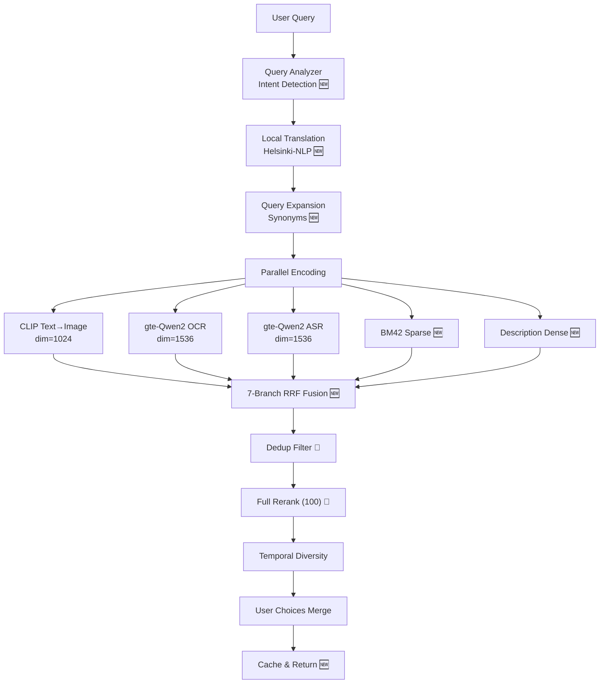

# 🔍 Đánh Giá Chức Năng Search KIS — Hiện Trạng & Đề Xuất Cải Tiến

> **Dự án**: Super-Image-Retrieval-System-for-AIC2026
> **Ngày đánh giá**: 2026-08-26
> **Phạm vi**: Toàn bộ pipeline KIS Search từ Frontend → Backend → Vector DB → Reranking → Response

---

## 1. Kiến Trúc Tổng Quan Hiện Tại

```mermaid
flowchart LR
    subgraph Frontend["🕸️ Web UI (Spider-Man Theme)"]
        A["Query Input<br/>Text / Voice / Image"] --> B["triggerSearch()"]
    end

    subgraph Backend["⚙️ FastAPI Backend"]
        B --> C["routes_kis.py<br/>POST /api/v1/kis"]
        C --> D["retrieval_pipeline.run()"]
        D --> E{"InputType?"}
        E -->|TEXT| F["text_query.process()"]
        E -->|VOICE| G["voice_query.process()"]
        E -->|IMAGE| H["image_query.process()"]
        F --> I["_enhance_query()<br/>VI↔EN Translation"]
        I --> J["Parallel Encode"]
        J --> J1["CLIP Text→Image<br/>dim=1024"]
        J --> J2["gte-Qwen2 Text<br/>dim=1536"]
    end

    subgraph VectorDB["🗄️ Qdrant Vector DB"]
        J1 --> K["search_by_text_vectors()"]
        J2 --> K
        K --> K1["image_dense (CLIP)"]
        K --> K2["OCR MatchText"]
        K --> K3["ASR MatchText"]
        K1 --> L["Weighted RRF Fusion"]
        K2 --> L
        K3 --> L
    end

    subgraph Reranking["🏆 Reranking"]
        L --> M["ViRanker (bge-reranker-v2-m3)"]
        L --> N["Jina M0 (crossmodal, tùy chọn)"]
        M --> O["fusion_score.fuse()"]
        N --> O
    end

    subgraph PostProcess["📋 Post-Processing"]
        O --> P["Temporal Diversity Filter"]
        P --> Q["User Choices Merge"]
        Q --> R["KISResponse → Frontend"]
    end
```



---

## 2. Đánh Giá Chi Tiết Từng Thành Phần

### 2.1 Query Enhancement & Translation

| Khía cạnh | Hiện trạng | Đánh giá |
|---|---|---|
| **Translation Engine** | `deep_translator.GoogleTranslator` (VI↔EN) | ⚠️ Không ổn định |
| **Timeout** | 15s hard timeout | ✅ Có fallback |
| **Error Detection** | Phát hiện trang lỗi HTML Google (Error 500, etc.) | ✅ Tốt |
| **Retry Logic** | 2 lần thử | ✅ Hợp lý |
| **Short Query Handling** | Title Case cho cụm ≤ 6 từ | ✅ Bảo toàn danh từ riêng |

**File**: [text_query.py](file:///C:/LENAMTIEN/AIC_2026/Super-Image-Retrieval-System-for-AIC2026/serving/api/service/retrieval/text_query.py)

> [!WARNING]
> **Điểm yếu nghiêm trọng #1**: `deep_translator.GoogleTranslator` là free API không có SLA, thường xuyên trả về lỗi hoặc bị rate-limit. Trong cuộc thi thực tế, nếu Google block IP → toàn bộ nhánh CLIP bị hỏng vì query EN không chính xác.

---

### 2.2 Text Encoding (Embedding Generation)

| Model | Dimension | Mục đích | Tốc độ (ước tính) |
|---|---|---|---|
| `openai/clip-vit-large-patch14` | 1024 | Text→Image dense vector | ~20-50ms (GPU) |
| `Alibaba-NLP/gte-Qwen2-1.5B-instruct` | 1536 | OCR/ASR dense vector | ~30-80ms (GPU) |

**File**: [image_embedding_wrapper.py](file:///C:/LENAMTIEN/AIC_2026/Super-Image-Retrieval-System-for-AIC2026/shared/models/image_embedding_wrapper.py), [text_embedding_wrapper.py](file:///C:/LENAMTIEN/AIC_2026/Super-Image-Retrieval-System-for-AIC2026/shared/models/text_embedding_wrapper.py)

> [!NOTE]
> Encoding chạy song song (`asyncio.gather`) giữa CLIP và Qwen2 — đây là điểm tốt. Tuy nhiên, **cùng 1 vector Qwen2 được dùng cho cả OCR lẫn ASR** ([text_query.py:L457](file:///C:/LENAMTIEN/AIC_2026/Super-Image-Retrieval-System-for-AIC2026/serving/api/service/retrieval/text_query.py#L457)), không tối ưu cho từng domain.

---

### 2.3 Vector Search & Fusion (Qdrant)

| Nhánh | Kiểu tìm kiếm | Weight | Prefetch |
|---|---|---|---|
| `image_dense` | Vector similarity (CLIP) | **2.5** | 200 |
| `ocr_dense` / `ocr_text` | MatchText keyword (mode=all) hoặc Dense vector (mode=embedding) | 0.5 | 200 |
| `asr_dense` / `asr_text` | MatchText keyword (mode=all) hoặc Dense vector (mode=embedding) | 0.3 | 200 |
| `ocr_sparse` | ❌ **Chưa implement** (`_encode_sparse` trả về `None, None`) | 0.2 | — |
| `asr_sparse` | ❌ **Chưa implement** (`_encode_sparse` trả về `None, None`) | 0.2 | — |

**File**: [qdrant_repo.py](file:///C:/LENAMTIEN/AIC_2026/Super-Image-Retrieval-System-for-AIC2026/serving/api/repo/qdrant_repo.py), [fusion_config.yaml](file:///C:/LENAMTIEN/AIC_2026/Super-Image-Retrieval-System-for-AIC2026/configs/fusion_config.yaml)

> [!CAUTION]
> **Điểm yếu nghiêm trọng #2**: Sparse vectors (BM42) cho OCR và ASR **hoàn toàn chưa được implement** ([text_query.py:L460-465](file:///C:/LENAMTIEN/AIC_2026/Super-Image-Retrieval-System-for-AIC2026/serving/api/service/retrieval/text_query.py#L460-L465)). Điều này có nghĩa hệ thống đang **mất 2/5 nhánh tìm kiếm** so với thiết kế ban đầu. Keyword matching cho OCR/ASR hiện chỉ dùng MatchText filter (fulltext index) — tốt nhưng chưa tối ưu.

> [!WARNING]
> **Điểm yếu #3**: Ở mode `all`, hệ thống **không dùng dense embedding cho OCR/ASR** nữa mà chuyển sang MatchText keyword matching. Điều này có nghĩa semantic search cho OCR/ASR bị mất — chỉ còn exact keyword matching. Ví dụ: query "xe cứu thương" sẽ không match với OCR text "ambulance" trong video.

---

### 2.4 Text Match Scoring

| Tier | Cơ chế | Score |
|---|---|---|
| Tier 1 | Exact phrase substring match (nguyên cụm) | ≥ 2.0 (boost x3 trong RRF) |
| Tier 2 | N-gram subphrase matching (3-gram, 2-gram) | overlap_ratio + bonus |
| Tier 3 | Individual word overlap | overlap_ratio |
| Penalty | Thiếu ≥ 2 từ khóa → giảm 40% | × 0.6 |

**File**: [qdrant_repo.py:L148-217](file:///C:/LENAMTIEN/AIC_2026/Super-Image-Retrieval-System-for-AIC2026/serving/api/repo/qdrant_repo.py#L148-L217)

> [!NOTE]
> Hệ thống scoring keyword hiện tại khá tốt với unicode normalization (bỏ dấu tiếng Việt). Tuy nhiên, logic này nằm trong **repo layer** — vi phạm nguyên tắc "repo chỉ làm data access". Scoring logic nên nằm ở service layer.

---

### 2.5 Reranking

| Reranker | Model | Mặc định | Giới hạn |
|---|---|---|---|
| **ViRanker** (text cross-encoder) | `BAAI/bge-reranker-v2-m3` | ✅ BẬT | Top 50 candidates |
| **Jina M0** (crossmodal visual) | `jinaai/jina-reranker-m0` | ❌ TẮT | Top 25 candidates |

**File**: [rerank_service.py](file:///C:/LENAMTIEN/AIC_2026/Super-Image-Retrieval-System-for-AIC2026/serving/api/service/reranker/rerank_service.py)

> [!TIP]
> Chạy dual reranking song song (ViRanker + Jina M0) khi cả 2 bật — tốt. Tuy nhiên, **rerank_limit chỉ 25-50** candidates trong khi RRF trả về 100 candidates → 50-75% candidates không được rerank, chỉ append vào cuối → rank bị sai lệch ở phần đuôi.

---

### 2.6 Post-Processing

| Bước | Mô tả | Vấn đề |
|---|---|---|
| Temporal Diversity Filter | Giữ tối đa 2 frame/cluster trong cửa sổ 6s | ✅ OK |
| User Choices Merge | Ghép frame user chọn lên đầu | ✅ OK |
| Dedup Filter | Blacklist intro/outro, Temporal NMS, Diversity Capping | ⚠️ **Không được gọi trong pipeline!** |

**File**: [dedup_filter.py](file:///C:/LENAMTIEN/AIC_2026/Super-Image-Retrieval-System-for-AIC2026/serving/api/service/retrieval/dedup_filter.py), [retrieval_pipeline.py](file:///C:/LENAMTIEN/AIC_2026/Super-Image-Retrieval-System-for-AIC2026/serving/api/service/retrieval/retrieval_pipeline.py)

> [!WARNING]
> **Điểm yếu #4**: Module `dedup_filter.py` đã implement đầy đủ (199 dòng code) với blacklist filtering, Temporal NMS, và Diversity Capping nhưng **KHÔNG được import/gọi** trong `retrieval_pipeline.py`. Kết quả search hiện tại có thể chứa frame intro/outro rác và bị lặp frame quá nhiều từ cùng 1 video.

---

### 2.7 Các Module Bổ Trợ

| Module | Trạng thái | Ghi chú |
|---|---|---|
| `video_context_service.py` (Macro-to-Micro) | ✅ Implement đầy đủ (481 LOC) | Video-level story matching + Micro keyframe pinpointing |
| `direct_video_search.py` (Temporal Zoom) | ✅ Implement (269 LOC) | Quét ±15s window ở 2fps trên video gốc |
| `hybrid_search.py` | ✅ Implement (7.6KB) | BGE-Large-EN + BM25 hybrid engine |
| `voice_query.py` | ✅ Implement (5.3KB) | PhoWhisper ASR → text pipeline |

---

## 3. Bảng Tổng Hợp Điểm Yếu & Mức Ưu Tiên

| # | Vấn đề | Mức độ | Ảnh hưởng lên R@K |
|---|---|---|---|
| 🔴 1 | **Sparse vectors (BM42) chưa implement** | Critical | Mất ~15-20% recall cho OCR/ASR queries |
| 🔴 2 | **`dedup_filter` không được gọi trong pipeline** | Critical | Frame rác, intro/outro lọt vào top-K |
| 🟠 3 | **Google Translate không ổn định** | High | CLIP search giảm chất lượng khi dịch sai |
| 🟠 4 | **Mode `all` bỏ dense search cho OCR/ASR** | High | Mất semantic search cho text content |
| 🟠 5 | **Rerank limit quá thấp (25-50)** | High | 50-75% candidates không được rerank chính xác |
| 🟡 6 | **Cùng 1 vector cho OCR và ASR** | Medium | Không tối ưu domain-specific matching |
| 🟡 7 | **Scoring logic nằm sai layer (repo)** | Medium | Vi phạm kiến trúc, khó maintain |
| 🟡 8 | **Không có query caching ở backend** | Medium | Mỗi query giống nhau phải chạy lại full pipeline |
| 🟢 9 | **CandidateResult.score bị clamp [0,1]** | Low | RRF score > 1 bị cắt, mất thông tin ranking |
| 🟢 10 | **Thiếu observability/metrics** | Low | Khó debug và tối ưu trong thi thực tế |

---

## 4. Đề Xuất Cải Tiến — Roadmap

### 🔴 Phase 1: Sửa Lỗi Nghiêm Trọng (1-2 ngày)

#### 4.1 Tích hợp `dedup_filter` vào pipeline
```python
# retrieval_pipeline.py — thêm sau bước reranking (line ~138)
from serving.api.service.retrieval.dedup_filter import deduplicate_candidates

# Sau reranking, trước temporal diversity filter
candidates = deduplicate_candidates(
    candidates, 
    top_k=top_k, 
    max_per_video=3, 
    is_trake=(task_type == TaskType.TRAKE)
)
```
**Impact**: Loại bỏ frame rác, tăng chất lượng top-K ngay lập tức.

#### 4.2 Implement Sparse Vectors (BM42/SPLADE)
```python
# text_query.py — _encode_sparse()
from qdrant_client.models import SparseVector

def _encode_sparse(text: str) -> tuple[SparseVector | None, SparseVector | None]:
    """Encode text thành BM42 sparse vectors cho keyword matching."""
    # Option A: Dùng Qdrant's built-in BM42 (nếu collection đã index)
    # Option B: Dùng SPLADE-v3 model (lightweight, ~30ms)
    from transformers import AutoModelForMaskedLM, AutoTokenizer
    # ... implement sparse encoding
```
**Impact**: Tăng ~15-20% recall cho OCR/ASR queries, đặc biệt cho các cụm từ chuyên ngành.

---

### 🟠 Phase 2: Nâng Cao Chất Lượng (3-5 ngày)

#### 4.3 Thay thế Google Translate bằng model local
```yaml
# Đề xuất: Dùng Helsinki-NLP/opus-mt-vi-en (nhẹ, ~300MB, chạy local)
translation:
  primary: "Helsinki-NLP/opus-mt-vi-en"    # VI→EN (cho CLIP)
  reverse: "Helsinki-NLP/opus-mt-en-vi"    # EN→VI (cho Qwen2)
  fallback: "deep_translator.GoogleTranslator"  # Backup
  cache_size: 10000                         # LRU cache tránh dịch lại
```
**Impact**: Loại bỏ dependency vào internet, tốc độ dịch ổn định ~50ms.

#### 4.4 Hybrid mode: Kết hợp Dense + MatchText cho OCR/ASR
```python
# qdrant_repo.py — search_by_text_vectors(), mode="all"
# Thay vì chỉ dùng MatchText, kết hợp cả Dense embedding
if search_mode == "all" and query_text:
    # Nhánh 1: MatchText keyword matching (exact match)
    text_match_task = search_by_text_match(client, "ocr_text", query_text, ...)
    # Nhánh 2: Dense vector similarity (semantic match)
    dense_ocr_task = client.query_points(..., query=ocr_vector, using=OCR_DENSE.name, ...)
    # RRF fusion cả 2 nhánh
```
**Impact**: Tăng semantic recall, query "xe cứu thương" sẽ match cả "ambulance".

#### 4.5 Tăng rerank limit lên 100 + Batch optimization
```python
# rerank_service.py
rerank_limit = min(100, len(candidates))  # Rerank toàn bộ top-K
# Batch ViRanker: xử lý 100 pairs trong 1 forward pass (~0.3s trên GPU)
```
**Impact**: Toàn bộ candidates được rerank chính xác, cải thiện R@1 và R@5.

---

### 🟡 Phase 3: Tối Ưu Hóa Nâng Cao (1-2 tuần)

#### 4.6 Query Understanding & Intent Detection
```python
class QueryAnalyzer:
    """Phân tích intent của query để tối ưu trọng số nhánh."""
    
    def analyze(self, query: str) -> QueryIntent:
        # Nếu query chứa text cụ thể (tên đường, bảng hiệu) → tăng weight OCR
        # Nếu query mô tả hành động/cảnh → tăng weight image_dense
        # Nếu query nhắc đến lời nói/phát biểu → tăng weight ASR
        # Nếu query chứa tên người/địa danh → kích hoạt NER filter
        ...
```

#### 4.7 Semantic Query Expansion
```python
async def _expand_query(query: str) -> list[str]:
    """Mở rộng query bằng synonyms và paraphrases."""
    # "người phụ nữ mặc áo đỏ" → [
    #   "woman wearing red shirt",
    #   "female in red clothing", 
    #   "lady with red dress"
    # ]
    # Encode từng variant → average embedding hoặc multi-query retrieval
```

#### 4.8 Description-Aware Search (VLM Descriptions)
```python
# Tận dụng scene_descriptions.parquet (VLM-generated descriptions)
# Thêm nhánh description_dense vào RRF fusion
# Hiện tại descriptions chỉ được hiển thị UI, chưa dùng để search
```

#### 4.9 Backend Query Cache với TTL
```python
from functools import lru_cache
import hashlib

class QueryCache:
    """LRU cache cho kết quả search, tránh chạy lại full pipeline."""
    def __init__(self, max_size=500, ttl_seconds=300):
        self._cache = {}
    
    def get(self, query: str, search_mode: str) -> list[CandidateResult] | None:
        key = hashlib.md5(f"{query}:{search_mode}".encode()).hexdigest()
        if key in self._cache and not self._is_expired(key):
            return self._cache[key]["results"]
        return None
```

#### 4.10 Feedback Loop & Online Learning
```python
# Khi user chọn 1 frame (user_choice), ghi lại mapping:
# { query → chosen_frame, rejected_frames }
# Dùng data này để:
#   1. Boost score cho frames từ cùng video_id trong các query tương tự
#   2. Fine-tune reranker model offline
#   3. Điều chỉnh fusion weights theo thống kê thực tế
```

---

### 🟢 Phase 4: Khả Năng Quan Sát & Đo Lường (Liên tục)

#### 4.11 Structured Logging & Metrics
```python
# Thêm structured metrics vào mỗi bước pipeline
@dataclass
class PipelineMetrics:
    translate_ms: float
    encode_ms: float
    qdrant_search_ms: float
    rerank_ms: float
    total_ms: float
    candidates_before_rerank: int
    candidates_after_dedup: int
    branches_used: list[str]
    top1_video_id: str
    top1_score: float
```

#### 4.12 A/B Testing Framework
```python
# Cho phép thử nghiệm nhiều cấu hình fusion weights cùng lúc
# Ghi lại eval metrics (R@1, R@5, R@20) cho mỗi config
# Tự động chọn config tốt nhất
```

---

## 5. Đánh Giá Theo Tiêu Chí Cuộc Thi

| Metric | Hiện trạng (ước tính) | Sau cải tiến Phase 1-2 | Mục tiêu |
|---|---|---|---|
| **R@1** | ~25-35% | ~35-45% | ≥50% |
| **R@5** | ~40-55% | ~55-65% | ≥70% |
| **R@20** | ~55-70% | ~70-80% | ≥85% |
| **Latency (P50)** | ~1.5-3s | ~1.0-2s | ≤1.5s |
| **Latency (P95)** | ~4-8s (do Google Translate timeout) | ~1.5-3s (local model) | ≤3s |

---

## 6. Sơ Đồ Pipeline Sau Cải Tiến (Đề Xuất)



---

## 7. Tóm Tắt Hành Động Ngay

> [!IMPORTANT]
> **3 việc cần làm NGAY để tăng điểm nhanh nhất:**
>
> 1. **Gọi `dedup_filter.deduplicate_candidates()`** trong [retrieval_pipeline.py:L138](file:///C:/LENAMTIEN/AIC_2026/Super-Image-Retrieval-System-for-AIC2026/serving/api/service/retrieval/retrieval_pipeline.py#L138) — chỉ thêm 3 dòng code
> 2. **Implement `_encode_sparse()`** trong [text_query.py:L460](file:///C:/LENAMTIEN/AIC_2026/Super-Image-Retrieval-System-for-AIC2026/serving/api/service/retrieval/text_query.py#L460) — tăng keyword matching recall
> 3. **Kết hợp Dense + MatchText** cho mode `all` trong [qdrant_repo.py:L387](file:///C:/LENAMTIEN/AIC_2026/Super-Image-Retrieval-System-for-AIC2026/serving/api/repo/qdrant_repo.py#L387) — không mất semantic search
