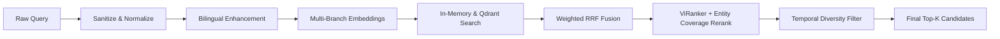

# 🔍 Thuật Toán Tìm Kiếm KIS (Known-Item Search)

Known-Item Search (KIS) là tác vụ tìm kiếm một phân đoạn video duy nhất (chứa keyframe mục tiêu) dựa trên câu mô tả chi tiết bằng văn bản hoặc giọng nói.

---

## 1. Pipeline Xử Lý Đa Tầng

---

## 2. Các Kỹ Thuật Đột Phá Đã Tích Hợp

### 1. In-Memory Tensor Hybrid Search (`HybridSearchEngine`)
- Nạp ma trận `description_embeddings.npy` (88,899 × 1024) trực tiếp vào PyTorch CUDA Tensor.
- Khi có query vector, thực hiện phép nhân ma trận song song `torch.matmul(desc_matrix, query_vec)` chỉ mất **~15ms** trên toàn bộ 88,899 scenes.
- Kết hợp `VectorizedSparseBM25Index` ma trận thưa BLAS CSR cho OCR & ASR.

### 2. Strict Exact-Match Tiered Scoring
Đối với các câu truy vấn chứa từ khóa đặc biệt (tiêu đề bài học, mã số, tọa độ hình học, tên riêng):
- **Tier 1 (Exact Full Phrase):** Thưởng điểm vượt trội ($+10.0$) khi toàn bộ cụm từ xuất hiện nguyên vẹn trong OCR.
- **Tier 2 (Consecutive Sub-phrases):** Thưởng điểm theo cụm từ liên tiếp ($+3.0$).
- **Tier 3 (Math/Coordinates):** Bắt chính xác tọa độ hình học (ví dụ: `(1;2;3)` hoặc `A(2,3,4)`).

### 3. ViRanker Multi-Clause & Entity Coverage Scorer
- Tách câu truy vấn dài thành các phân đoạn mệnh đề thực thể.
- Tính điểm bao phủ thực thể (Entity Coverage): Nếu câu hỏi đề cập 5 thành phần (ví dụ: *dĩa thịt, hạt nêm, nước cốt dừa, cà ri, mộc nhĩ*), candidate nào chứa càng nhiều thực thể sẽ được cộng dồn trọng số để đẩy lên Top 1.

### 4. Temporal Diversity Filter (Slide Burst Suppression)
- Khi video bài giảng có cùng 1 slide đứng yên trong 20-30 giây (sinh ra nhiều keyframe liên tiếp giống hệt nhau), thuật toán Temporal NMS sẽ lọc bỏ các keyframe liền kề (khoảng cách $< 5.0\text{s}$), chỉ giữ lại keyframe đại diện có điểm cao nhất để đảm bảo kết quả đa dạng và không bị chiếm chỗ.
