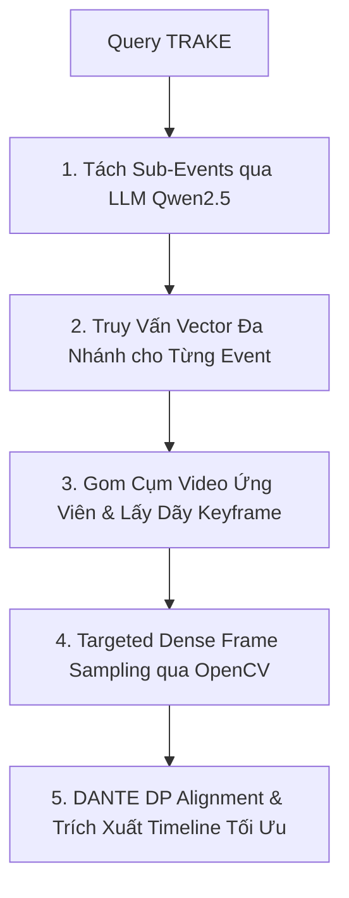

# ⏱️ Thuật Toán Tìm Kiếm Theo Dòng Thời Gian TRAKE (DANTE Engine)

TRAKE (Temporal Retrieval for Actions and Key Events) là bài toán tìm kiếm chuỗi sự kiện đa bước diễn ra tuần tự theo thời gian trong cùng một video (ví dụ: *Bước 1: Trộn bột -> Bước 2: Nặn bánh -> Bước 3: Chiên trong chảo dầu*).

---

## 1. Nguyên Lý Thuật Toán DANTE DP

Hệ thống triển khai thuật toán quy hoạch động **DANTE (Dynamic Alignment Network for Temporal Events)** để tìm đường đi tối ưu thỏa mãn ràng buộc thứ tự thời gian:
$$t_1 < t_2 < \dots < t_N$$

### Ma Trận Điểm và Công Thức Quy Hoạch Động:
Cho ma trận tương đồng $S[i, t]$ (độ tương đồng giữa sub-event $i$ và keyframe tại thời điểm $t$):

$$D[i, t] = S[i, t] + \max_{t' < t} \left( D[i-1, t'] - \lambda \cdot \text{gap}(t, t') \right)$$

Trong đó:
- $S[i, t]$: Điểm kết hợp giữa cosine similarity CLIP vector và text match.
- $\lambda \cdot \text{gap}(t, t')$: Hàm phạt khoảng cách thời gian giữa các bước liên tiếp.

---

## 2. Quy Trình Thực Thi 5 Bước

1. **Sub-Event Parsing:** Phân tích câu query tiếng Việt thành danh sách $N$ sự kiện con độc lập.
2. **Multi-Query Retrieval:** Mỗi sub-event được mã hóa và truy xuất song song trên toàn bộ database.
3. **Video-Level Aggregation:** Gom các keyframe thuộc cùng 1 video lại thành một chuỗi thời gian $T$.
4. **Targeted Dense Sampling:** Mở video gốc bằng OpenCV để lấy mẫu khung hình dày đặc ($\Delta = 0.5\text{s}$) tại phân đoạn tiềm năng.
5. **DANTE DP Extraction:** Tìm bộ tuple $(kf_1, kf_2, \dots, kf_N)$ có tổng điểm liên kết cao nhất.
