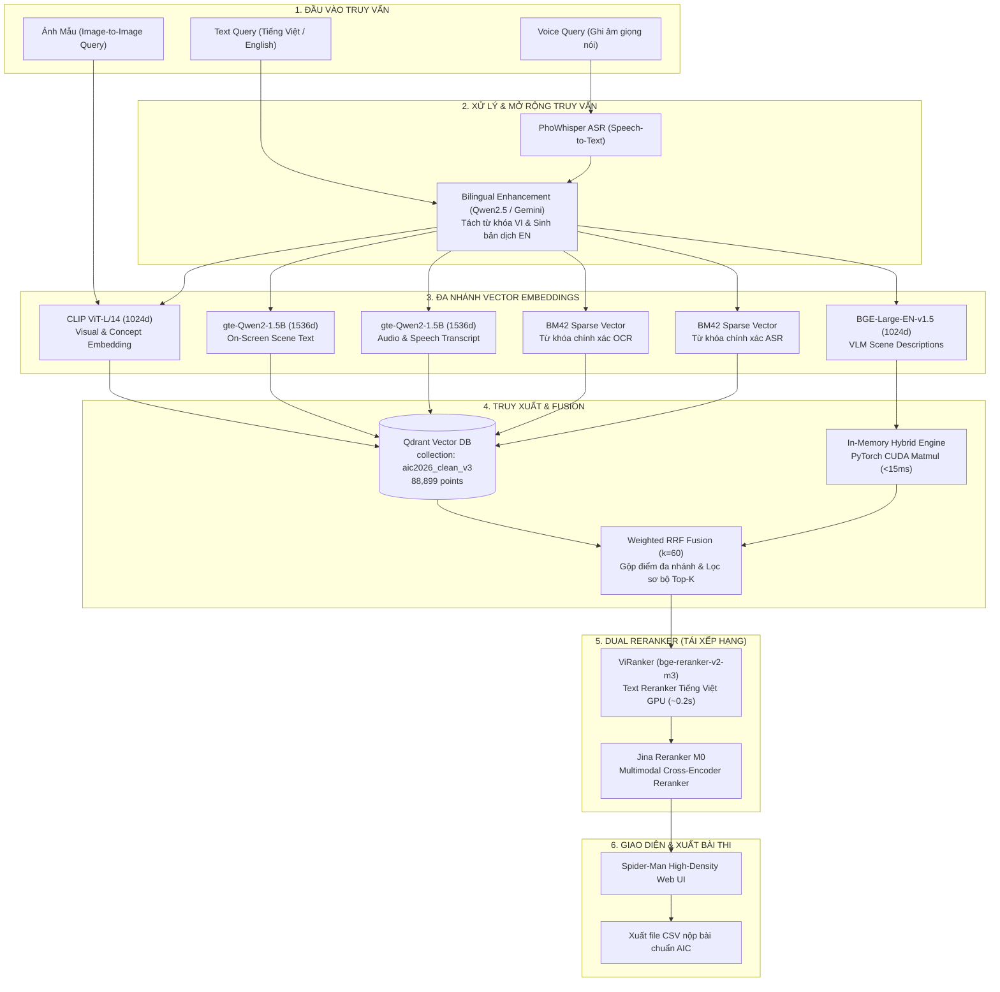

# 🏗️ Kiến Trúc Hệ Thống (System Architecture)

Hệ thống Super Image Retrieval System được xây dựng theo mô hình **Multi-Stage Retrieval & Reranking** kết hợp xử lý vector đa nhánh (Multi-Branch Vector Embeddings), In-Memory Tensor Dot-Product và Dual Cross-Encoder Rerankers.

---

## 1. Sơ Đồ Khối Tổng Quan

---

## 2. Các Tầng Xử Lý Chính

### Tầng 1: Phân Tích & Mở Rộng Truy Vấn (Query Processing)
- **Tự động nhận diện Intent:** Tách bạch câu hỏi thị giác (VQA), chuỗi thời gian (TRAKE), hay tìm kiếm thực thể (KIS).
- **Song ngữ thông minh (Bilingual Normalization):**
  - Giữ nguyên tiếng Việt có dấu chuẩn hóa cho OCR, ASR và ViRanker.
  - Dịch sang tiếng Anh chính xác cao (bảo tồn văn hóa ẩm thực, trang phục, địa danh Việt Nam) qua Google API / Qwen2.5 cho visual CLIP.

### Tầng 2: Đa Nhánh Embeddings & Hybrid Search
- **Visual Dense Branch (1024d):** Trích xuất bởi `openai/clip-vit-large-patch14`.
- **Text Dense Branch (1536d):** Trích xuất bởi `Alibaba-NLP/gte-Qwen2-1.5B-instruct`.
- **Description Dense Branch (1024d):** Trích xuất bởi `BAAI/bge-large-en-v1.5`, được nạp sẵn lên GPU VRAM phục vụ phép nhân ma trận song song `torch.matmul` siêu tốc ($< 15\text{ms}$ cho 88,899 scenes).
- **Sparse BM25/BM42 Branch:** Bắt chính xác từng từ khóa, mã số, biển báo, công thức toán học và tọa độ.

### Tầng 3: Reciprocal Rank Fusion (Weighted RRF)
Kết hợp thứ hạng của các nhánh tìm kiếm với trọng số cấu hình động (`configs/fusion_config.yaml`):
$$\text{RRF\_Score}(d) = \sum_{b \in \text{Branches}} w_b \cdot \frac{1}{k + \text{rank}_b(d)}$$

### Tầng 4: Dual Rerankers (Tái Xếp Hạng Chính Xác Cao)
1. **ViRanker (`bge-reranker-v2-m3`):** Reranker ngữ nghĩa tiếng Việt đa câu kết hợp thuật toán Entity Coverage Scorer để đảm bảo candidate phải chứa đủ các thực thể cốt lõi của câu truy vấn.
2. **Jina Cross-modal Reranker M0:** Cross-attention giữa ảnh keyframe và văn bản truy vấn.

---

## 3. Danh Mục Mô Hình AI (Model Specifications)

| Mô Hình | Vai Trò & Vector Dim | Model ID HuggingFace | Thiết Bị | VRAM/RAM |
|---|---|---|---|---|
| **CLIP ViT-L/14** | Visual Embedding (1024d) | `openai/clip-vit-large-patch14` | CUDA / MPS | ~1.7 GB |
| **gte-Qwen2-1.5B** | Text Embedding (1536d) | `Alibaba-NLP/gte-Qwen2-1.5B-instruct` | CUDA / MPS | ~3.0 GB |
| **ViRanker (BGE-M3)** | Text Cross-Encoder | `BAAI/bge-reranker-v2-m3` | CUDA / MPS | ~2.3 GB |
| **Jina Reranker M0** | Multimodal Reranker | `jinaai/jina-reranker-m0` | CUDA | ~2.5 GB |
| **PhoWhisper-medium** | Vietnamese ASR | `vinai/PhoWhisper-medium` | CPU / CUDA | ~1.5 GB |
| **bge-large-en-v1.5** | Description Vector (1024d) | `BAAI/bge-large-en-v1.5` | CUDA / CPU | ~2.0 GB |
| **Qwen2.5-1.5B** | Event Splitter & Enhancer | `Qwen/Qwen2.5-1.5B-Instruct` | CUDA | ~3.0 GB |

---

## 4. Hiệu Năng Truy Vấn Thực Tế (Latency Profiling)

| Thành phần xử lý | Thời gian | Ghi chú |
|---|---|---|
| **Query Enhancement & Translation** | ~0.8s - 1.2s | Cache hit $< 1\text{ms}$ |
| **Multi-Branch Vector Encoding** | ~0.05s - 0.25s | Batch GPU CUDA |
| **In-Memory & Qdrant Search** | ~0.02s - 0.15s | Hybrid CUDA Tensor |
| **ViRanker Top-50 Reranking** | ~0.4s - 0.6s | Multi-clause Sentence-Max |
| **Tổng End-to-End Latency** | **~1.5s - 2.2s** | Đạt chuẩn thi đấu real-time |
